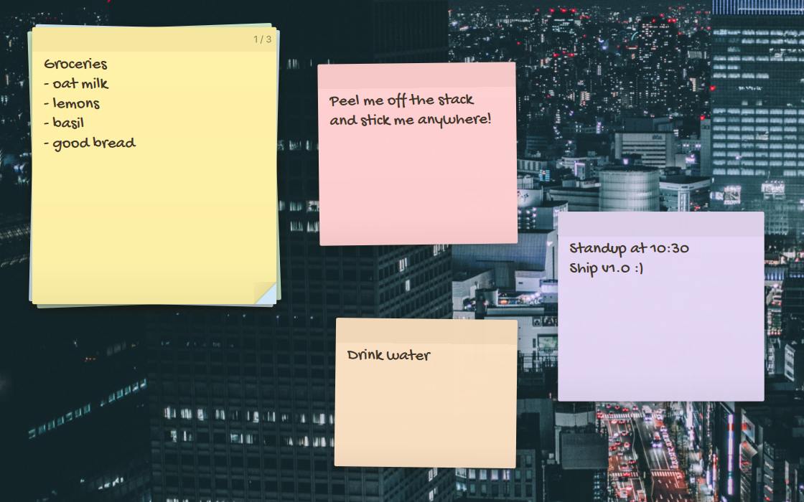

# Sticky Notes for Dux Shell



A desktop stack of paper notes. Click the sheet and start typing; an empty stack creates a note as soon as you type. Controls stay out of the way until you hover or focus the stack:

- **Top band**: drag it to move the stack (a preview follows, and the stack lands on release). Scroll over it, use **‹ / ›**, or press Ctrl+PgUp / Ctrl+PgDn to flip sheets. **+** or Ctrl+N starts a new sheet. If the current sheet is still blank, it is reused rather than piling up empty ones.
- **Bottom row**: paper color, font (handwriting, your shell font, or your monospace font), and delete. Deleting shows **Undo** for a few seconds instead of asking for confirmation.
- **Folded corner**: drag it to peel the top sheet off and drop it anywhere on the desktop, or click it to place the sheet beside the stack.

Peeled sheets sit on the desktop and are edited directly by clicking. Drag a sheet's top band to move it, drag its bottom-right corner to resize it, and drop it on the stack (or press the stack icon) to put it back. Escape leaves the editor. Edits save automatically.

## Installation

Install **Sticky Notes** from Dux Settings → Plugins, enable it, then add it under Settings → Desktop Widgets.

## Settings

Each stack has its own settings under Settings → Desktop Widgets:

- **Notes folder**: where `notes.json` lives. Leave it empty for the default, which is created automatically. A folder you choose must already exist and be writable; the settings page checks it as you type, and the stack shows an error instead of creating a mistyped folder. Two stacks with different folders are independent.
- **Handwriting font**: any installed font for the handwriting style. The other styles follow your shell and monospace fonts.
- **Text size**: note text size relative to your shell font size.

## Local development

Requires Dux Shell 2.0 or newer; there are no other dependencies. The default handwriting font is [Gochi Hand](https://fonts.google.com/specimen/Gochi+Hand); install it for the intended look or pick another in the settings. To work on it, link the repository into the Dux plugin directory and enable it as above:

```sh
ln -s "$PWD" ~/.config/dms/plugins/stickyNotes
dms ipc call plugin-scan scan
```

If your shell needs a refresh, use the plugin browser's rescan or restart Dux. Resize the stack with Dux's desktop widget editing controls; move it by dragging its top band. Dux saves its geometry and display settings. Leave **Show on overlay** and **Show on overview** disabled: Dux's normal desktop widget surface uses the Wayland **bottom** layer, beneath application windows and launcher surfaces, above the wallpaper's background layer. Actual ordering of surfaces within a layer depends on the compositor and other shell configuration.

Notes are stored as UTF-8 JSON in `~/.local/share/sticky-notes/notes.json` (or `$XDG_DATA_HOME/sticky-notes`), created on first use. The file is written atomically. If the file is unreadable or malformed, the widget reports an error and does not overwrite it. Peeled sheets are drawn on one transparent, full-screen bottom-layer surface on the stack's display. Its input region covers only the sheets, so clicks elsewhere reach the desktop. Sheets, peels and stack moves stay inside the area left free by panels (the Dux bar, docks or other layer-shell clients), measured with an invisible probe surface. Several stacks share the one file and pick up each other's changes live, but if two stacks edit the same note at once, the last save wins. Dux placement can be configured per display, but workspace-specific notes are not implemented. The widget should not be added to the lock screen, where private notes could be visible.

## Checks

```sh
qmlformat -n src/StickyNotes.qml >/dev/null
```

## License

MIT
